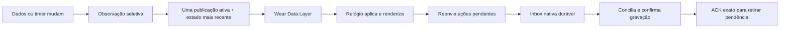

# Android/Wear: lentidão na reabertura e diagnóstico

Relato: após fechar o aplicativo no relógio e pedir para abri-lo pelo celular, o Android ficou muito lento e a reconexão falhou. [Design](../superpowers/specs/2026-10-29-wear-sync-flow-design.md) e [plano](../superpowers/plans/2026-10-29-wear-sync-flow.md). O usuário preferiu testar os aparelhos depois; não foi feita instalação física nesta entrega.

## Defeitos reproduzidos

| Entrada | Antes | Depois |
|---|---|---|
| 25 eventos apenas de UI, sem trabalho novo | 26 leituras da inbox nativa | Somente a leitura inicial; os eventos não iniciam dreno |
| Rajada com publicação nativa retida e reabertura pedida | 30 publicações na frente da abertura | Uma publicação ativa e a atualização mais recente pendente; no máximo dois envios no teste |
| Captura iniciada no relógio, concluída no celular, conciliada três vezes | Três gravações do treino | Limite confirmado mantido; repetição sem nova gravação |
| Três notificações de estado recebidas pela Activity | Três novos pedidos de estado | Apenas render/replay, sem novos pulls |

Os três primeiros foram observados falhando nos testes JS antes de alterar a produção. A última regressão foi observada no emulador ao restaurar temporariamente o receiver antigo: contagem esperada 1, encontrada 4. Com render/replay, passou. São mecanismos concretos de trabalho repetido; não comprovam, sozinhos, a causa completa da lentidão nos aparelhos do relato.

## Fluxo atual

Ticks de contagem regressiva e mudanças de UI/status da nuvem não drenam a fila nem percorrem o histórico. A entrada nativa, a prontidão/troca de dono e a retomada nativa continuam acordando a inbox. Somente snapshots podem ser substituídos no mailbox; ações e medições mantêm os recibos duráveis existentes.

O handshake manual tem prioridade própria, separado do pull mais recente de cada nó. Pedidos substituídos liberam a proteção de CPU sem ACK de aplicação. Falha na primeira publicação não deixa a ponte definitivamente sem comando de sincronização. A conciliação cardíaca agrupa solicitações concorrentes e reutiliza adoção já confirmada; restauração sob demanda e falhas de disco conservam a barreira de gravação.

No relógio há somente um pull em andamento, com correlação e expiração. Pausar a Activity invalida callbacks antigos. Receber uma atualização não gera um novo pedido automático; o pull periódico e Reconectar continuam disponíveis.

## Diagnóstico para o próximo teste

Na versão debug do relógio: **Opções → Diagnóstico da sincronização** (título da página: **Debug**).

- **Celular:** telefone encontrado pela descoberta Wear.
- **RX/TX e Estado:** recebimentos/envios, idade do último estado aplicado e revisão.
- **Ações/Batimentos:** pendências de aplicação e de capturas.
- **ACK:** sequência da última confirmação observada.
- **Etapa/Último erro:** códigos como `discover`, `sync-send`, `state`, `replay-send`, `no-phone`, `send-failed`, `state-rejected` ou conflito de alvo/campo. O último erro é mantido como histórico; não é, por si só, o estado atual da conexão.

O logcat com tag **OpenGymSync** acrescenta contagens e durações nas fronteiras do telefone/relógio. Os novos logs não recebem payload completo, conta, nome de exercício, token ou leituras cardíacas. Contadores ficam em memória; a página não grava em cada tick. A captura real do emulador foi inspecionada em `frontend/android/wear/build/sync-evidence-20261029/diagnostics.png` (ignorada pelo Git).

Abrir remotamente continua sujeito às regras de lançamento em background do Android/Wear. O pedido mantém a notificação para abertura manual; a etapa `visible` só é registrada quando a Activity entra em primeiro plano. Entrega da mensagem e abertura visível são evidências diferentes.

## Validação

- **362 arquivos / 3.952 testes web**, aprovados, incluindo persistência real, reabertura sem feedback e os contratos anteriores de dados offline.
- **9 unitários do celular + 68 Wear**, aprovados; pull concorrente/expirado, callback antigo e diagnóstico com códigos permitidos cobertos.
- **11 instrumentados Wear + 3 celular**, aprovados: diagnóstico, ausência de pull recursivo, reabertura, diário/curvas duráveis, AtomicFile e telefone com tela apagada. A última alteração de título foi novamente validada pelo teste de diagnóstico e por inspeção da captura.
- Revisão independente do conjunto sem achados críticos, importantes ou menores. Sem alteração de formato de diário, ACK, dependência ou layout de treino/descanso.
- Scripts, idiomas, bundles e APKs finais verificados pelo executor; hashes e logs ficam na evidência local de build. Nenhum dado dos aparelhos foi apagado, e o visualizador de movimento permaneceu fechado.

**Limite:** desempenho, reconexão e abertura no S23 Ultra/Watch Ultra ainda precisam de medição real. O usuário adiou esse teste. Os APKs ficam prontos para a atualização posterior dos dois aparelhos; os resultados de emulador não são apresentados como confirmação de sensor ou rede reais.
